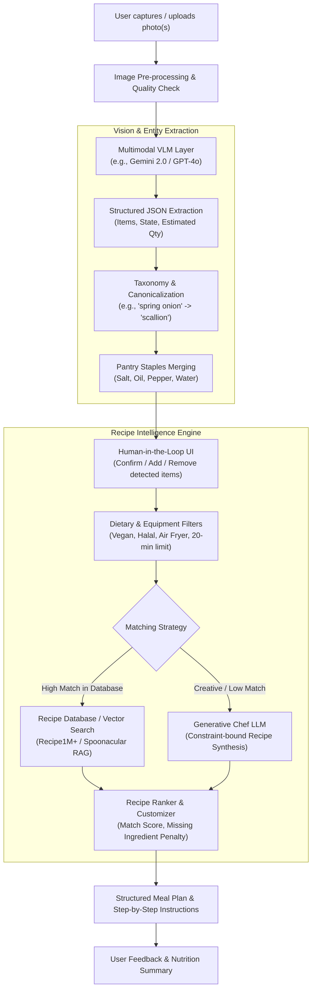

# "Snap-to-Meal" AI: System Architecture & Development Workflow

A comprehensive engineering guide and end-to-end development roadmap to build an AI that detects available ingredients from photos (fridge, pantry, countertop) and generates optimal, practical meals.

---

## 1. System Architecture Overview



---

## 2. Core AI Pipeline Options: Architectural Trade-Offs

When designing this system, there are three primary approaches:

| Strategy | Architecture | Pros | Cons | Recommendation |
| :--- | :--- | :--- | :--- | :--- |
| **Approach 1: Direct End-to-End VLM** | Photo directly fed to Multimodal LLM (Gemini 2.0 Flash / GPT-4o) with a structured prompt. | • Fastest to prototype<br>• Understands context (e.g., leftover containers, half-empty jars)<br>• Zero training required | • Occasional hallucinations on occluded items<br>• Token cost per image query | **Best for MVP & Rapid Launch** |
| **Approach 2: Two-Stage (Object Detection + LLM)** | YOLOv11/SAM fine-tuned on Grocery datasets $\rightarrow$ list of bounding boxes $\rightarrow$ LLM for recipes. | • Low inference latency<br>• Fully deterministic detection<br>• Cheaper at scale | • Struggle with cut/cooked items<br>• High data labeling cost<br>• Rigid taxonomy | Best for industrial grocery checkout, not home fridges |
| **Approach 3: Hybrid VLM + RAG + Guardrails (Recommended Production Setup)** | VLM extracts structured inventory $\rightarrow$ Canonical normalization $\rightarrow$ Vector/Database RAG for recipes $\rightarrow$ LLM customizes steps. | • High accuracy<br>• Proven, safe culinary recipes<br>• User can review ingredients before cooking | • Slightly more moving parts than pure prompt | **Best for Scalable, High-Quality User Experience** |

---

## 3. End-to-End Development Workflow (Sprint Plan)

### Phase 1: Ingestion & Vision Extraction Engine
**Objective:** Turn a messy photo into a validated, structured JSON list of food items.

1. **Camera / Photo Capture Best Practices:**
   - Allow multiple photos (e.g., Fridge Door + Main Shelves + Crisper Drawer).
   - Compress images client-side (Max 1500px on long edge, JPEG quality 80) to optimize latency.
2. **Multimodal Extraction Prompting:**
   - Use strict structured outputs (JSON Schema / Pydantic models).
   - Differentiate between **Core Ingredients** (e.g., chicken breast, bell pepper) and **Condiments/Sauces** (e.g., sriracha, mayonnaise).
   - Request confidence levels and estimated state (fresh, ripe, canned, frozen).

### Phase 2: Ingredient Taxonomy & Normalization
**Objective:** Prevent duplicate or mismatched ingredients.

1. **Canonical Mapping:**
   - Map aliases to standard names: `"cilantro"` $\leftrightarrow$ `"coriander"`, `"capsicum"` $\leftrightarrow$ `"bell pepper"`.
2. **Default Pantry Presumptions:**
   - Most kitchens have basic staples: Salt, Black Pepper, Cooking Oil, Water, Sugar.
   - Maintain a toggle in UI: *"Include common pantry staples"*.
3. **Interactive Validation Step:**
   - Never generate recipes immediately without showing the user what was detected.
   - Provide quick chip-tags where the user can tap `[x]` to remove a misidentified item or type to add missing items.

### Phase 3: Recipe Recommendation & Generation
**Objective:** Provide realistic recipes that minimize missing ingredients.

1. **Scoring Algorithm for Matching Existing Recipes:**
   $$\text{Match Score} = \frac{|\text{Detected Ingredients} \cap \text{Recipe Ingredients}|}{|\text{Recipe Required Ingredients}|} - \lambda \cdot (\text{Missing Critical Ingredients})$$
   - Critical items (e.g., protein, starches) have higher penalty if missing compared to garnishes (e.g., parsley).
2. **Generative "Creative Chef" Mode:**
   - When no standard recipe matches $>70\%$, prompt the LLM to invent a dish combining the ingredients harmoniously.
   - Constrain the LLM: *Only use the validated ingredients + approved spices. Specify substitution ideas if something is missing.*

### Phase 4: UI/UX & Output Presentation
**Objective:** Deliver actionable, easy-to-follow cooking instructions.

- **Categorized Proposals:**
  - **Quick & Easy** (under 20 minutes).
  - **Best Match** (0 missing ingredients).
  - **Gourmet Upgrade** (requires 1–2 easy store items).
- **Output Schema per Recipe:**
  - Dish Name & Short Description.
  - Prep Time & Cook Time.
  - Difficulty Level (Beginner / Intermediate / Advanced).
  - Used Ingredients vs. Missing Ingredients.
  - Step-by-Step Cooking Guide.
  - Chef Tip / Dietary Tags (Gluten-Free, High-Protein, Low-Carb).

---

## 4. Production Tech Stack Recommendation

- **Mobile / Web Frontend:**
  - React Native / Flutter (for iOS & Android camera integration) OR Next.js + Tailwind CSS + PWA.
- **Backend API:**
  - Python (FastAPI): Native async support, high compatibility with AI libraries (`pydantic`, `google-genai`, `openai`).
- **AI & Vision:**
  - **Primary VLM:** Gemini 2.0 Flash (Fastest multimodal vision response times and cost efficiency) or GPT-4o-mini.
- **Recipe Knowledge Base (Optional for RAG):**
  - Spoonacular API / Food.com Open Dataset / Recipe1M+.
  - Vector Store: Qdrant, ChromaDB, or PostgreSQL with `pgvector`.
- **Hosting:**
  - Backend: Cloud Run / AWS ECS / Render.
  - Image storage: AWS S3 or Cloudflare R2 (with 24h retention policy for privacy).

---

## 5. Starter Implementation Blueprint (FastAPI + Vision VLM)

Here is a working reference implementation demonstrating the core vision extraction and recipe generation pipeline:

```python
# main.py
import os
import json
from typing import List, Optional
from fastapi import FastAPI, UploadFile, File, Form
from pydantic import BaseModel, Field
from google import genai
from google.genai import types

app = FastAPI(title="Snap-to-Meal AI API")
client = genai.Client(api_key=os.getenv("GEMINI_API_KEY"))

# Pydantic Schemas for Structured Output
class DetectedIngredient(BaseModel):
    name: str = Field(description="Canonical ingredient name, e.g., 'egg', 'tomato'")
    category: str = Field(description="'produce', 'protein', 'dairy', 'condiment', 'grain', 'other'")
    estimated_quantity: Optional[str] = Field(description="e.g., '3 units', 'half jar', 'approx 200g'")
    confidence: float = Field(description="Confidence between 0.0 and 1.0")

class IngredientExtractionResponse(BaseModel):
    ingredients: List[DetectedIngredient]
    potential_pantry_staples: List[str]

class RecipeStep(BaseModel):
    step_number: int
    instruction: str

class Recipe(BaseModel):
    title: str
    description: str
    difficulty: str
    prep_time_minutes: int
    cook_time_minutes: int
    used_ingredients: List[str]
    missing_ingredients: List[str]
    instructions: List[RecipeStep]
    chef_notes: str

class RecipeResponse(BaseModel):
    recipes: List[Recipe]

@app.post("/extract-ingredients", response_model=IngredientExtractionResponse)
async def extract_ingredients(image: UploadFile = File(...)):
    """Passes photo to VLM to identify all edible ingredients."""
    image_bytes = await image.read()
    
    prompt = """
    Analyze this refrigerator/pantry/countertop image carefully.
    Identify all visible edible ingredients, produce, proteins, dairy, and condiments.
    Ignore containers unless food inside is identifiable.
    Return the response strictly adhering to the JSON schema.
    """
    
    response = client.models.generate_content(
        model="gemini-2.0-flash",
        contents=[
            types.Part.from_bytes(data=image_bytes, mime_type=image.content_type),
            prompt
        ],
        config=types.GenerateContentConfig(
            response_mime_type="application/json",
            response_schema=IngredientExtractionResponse,
            temperature=0.2
        )
    )
    return json.loads(response.text)

@app.post("/generate-recipes", response_model=RecipeResponse)
async def generate_recipes(
    ingredients: str = Form(..., description="JSON string of validated ingredients"),
    dietary_preferences: Optional[str] = Form(None, description="e.g., 'Vegetarian', 'Quick under 20m'")
):
    """Generates optimal meals matching the confirmed ingredients."""
    prompt = f"""
    You are an expert chef. Based strictly on the available ingredients provided below,
    suggest 3 distinct meal recipes:
    1. 'Max Utilization': Uses the most ingredients with 0 missing items.
    2. 'Speedy': Quickest meal to make (< 20 mins).
    3. 'Creative Twist': Highly flavorful culinary recipe, at most 1-2 common missing ingredients.

    Available Ingredients:
    {ingredients}

    Dietary Preferences / Restrictions:
    {dietary_preferences or 'None'}

    Assume standard pantry staples (water, salt, pepper, basic cooking oil) are available.
    """
    
    response = client.models.generate_content(
        model="gemini-2.0-flash",
        contents=prompt,
        config=types.GenerateContentConfig(
            response_mime_type="application/json",
            response_schema=RecipeResponse,
            temperature=0.6
        )
    )
    return json.loads(response.text)
```

---

## 6. Edge Cases & Safety Protocols

> [!WARNING]
> **Food Safety & Allergy Disclaimers**
> Computer vision cannot reliably detect bacterial spoilage, botulism, or hidden allergens (e.g. peanut cross-contamination). Always include explicit disclaimers:
> - Instruct users to inspect food for odor, mold, and expiry dates before cooking.
> - Explicitly prompt the user to input severe allergies, and configure the LLM to verify every ingredient against an allergen blacklist.

1. **Occlusion & Messy Fridges:**
   - Deep shelves hide items behind jars. Instruct users in the UI: *"For best results, take one photo of the main shelves and one of the door/crisper"*.
2. **Ambiguous Liquids / Leftovers:**
   - Leftovers in Tupperware cannot be identified reliably by vision. The system should tag them as `"unidentified leftover"` and prompt the user: *"What's in the clear container on shelf 2?"*.
3. **Culinary Viability Guardrails:**
   - Prevent absurd recipes (e.g., pairing strawberries with garlic sauce simply because both are present). Enforce culinary cuisine coherence prompts.

---

## 7. Next Action Steps

1. **Set Up Project Skeleton**: Create a clean repository with `/backend` (FastAPI) and `/frontend` (React/Vite).
2. **Acquire API Keys**: Set up Gemini or OpenAI API access.
3. **Test with 5 Real Fridge Photos**: Benchmark extraction accuracy on your own fridge to tune prompt instructions before writing full UI.
